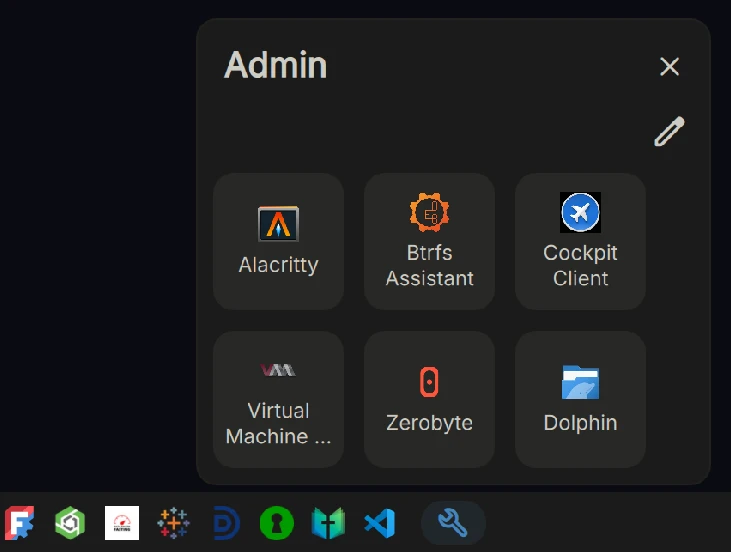

# App Stack — DMS Bar Widget Plugin

A [Dank Material Shell](https://danklinux.com) bar widget that groups related apps behind a single icon. Click the icon to open a popout grid of app shortcuts. Create additional groups directly from the settings panel — each group is an independent bar icon with its own app list.

  

---

## Overview

The built-in Apps Dock widget in DMS shows a single shared list of pinned apps across all instances. App Stack solves this by giving each copy of the plugin its own independent app list, so you can have a "Dev Tools" icon and a "Media" icon on your bar that each open their own curated set of shortcuts.



---

## Requirements

| Requirement | Purpose |
|---|---|
| Dank Material Shell 1.4+ | Plugin host |
| **Python 3** *(optional)* | **"Choose from Installed Apps"** picker only |

Python 3 is **not required** for the core plugin. The manual "Add App" form (Name / Icon / Command) works without it. If Python is missing, clicking "Choose from Installed Apps" will show an error message with install instructions. Everything else — the bar widget, popouts, group creation — uses only shell built-ins.

Install Python 3 if you want the app picker:
```bash
# Arch / CachyOS / Manjaro
sudo pacman -S python

# Fedora
sudo dnf install python3

# Debian / Ubuntu
sudo apt install python3
```

---

## Getting the plugin

```bash
git clone https://github.com/ubikq/dms-app-stack.git
```

---

## Installation (first group)

```bash
# Copy the plugin directory into the DMS plugins folder
cp -r dms-app-stack ~/.config/DankMaterialShell/plugins/appStack_default

# Activate
# Settings → Plugins → Scan for Plugins → toggle "App Stack - Default" on → dms restart

# Add to your bar
# Settings → DankBar → add "App Stack - Default" to a section
```

No further editing is required — the plugin ID is already set to `appStack_default`.

---

## Configuration

Open **Settings → Plugins → App Stack - Default** to configure everything — no file editing or JSON required.

### Group settings

| Setting | Description | Default |
|---|---|---|
| **Group Label** | Name shown in the popout header | `App Stack` |
| **Bar Icon** | [Material icon](https://fonts.google.com/icons) name shown in DankBar | `apps` |
| **Show label in bar** | Display the group name next to the icon | off |

### Managing apps

The **Apps** section shows your current app list with a form to add new entries.

**Add App (manual)** — fill in Name, Icon, and Command, then click **Add App**:

| Field | Description |
|---|---|
| **Name** | Display label shown below the icon in the popout |
| **Icon** | [Material icon](https://fonts.google.com/icons) name (e.g. `code`, `movie`) |
| **Command** | Shell command to launch the app (e.g. `firefox`) |

**Choose from Installed Apps** — opens a searchable list of all applications found in your system's `.desktop` files (including Flatpak). Selecting an app fills in all fields automatically and shows the app's real icon in the popout.

Up to **10 apps** per group. A recommendation to create another group is shown when you reach the limit. Remove any app with the × button.

### Finding material icon names

Browse at [fonts.google.com/icons](https://fonts.google.com/icons). Use the snake_case name shown under each icon (e.g. `open_in_new`, `folder_open`, `music_note`).

### Example manual commands

| App | Command |
|---|---|
| Firefox | `firefox` |
| Flatpak app | `flatpak run com.example.App` |

---

## Creating additional groups

Additional groups are created directly from the settings panel — no manual file copying required.

1. Open **Settings → Plugins → App Stack - Default**
2. Scroll to **Create Another Group** at the bottom
3. Click **New Group…**
4. Enter a short **group name** (e.g. `media`). The plugin name and directory are generated automatically:
   - Plugin name: `App Stack - media`
   - Directory: `~/.config/DankMaterialShell/plugins/appStack_media`
5. Click **Create Group** and read the confirmation carefully
6. Click **Confirm — Create**
7. Go to **Settings → Plugins → Scan for Plugins** → enable **App Stack - media** → **dms restart**
8. Add the new group to your bar via **Settings → DankBar**

Each group is fully independent — its own settings, its own app list, its own bar icon position. Configure the new group's icon, label, and apps through **Settings → Plugins → App Stack - media** (not the Default group).

> **Naming convention:** All App Stack instances share the `appStack_` prefix so they sort together in the plugins view and filesystem. Spaces in the group name are replaced with underscores in the directory name (e.g. `Dev Tools` → `appStack_Dev_Tools`).

> **Technical note:** DMS requires each bar widget to be a separate plugin instance with a unique ID. The Create flow copies this plugin directory and patches the ID automatically. The `plugin.json` `id` and `AppGroupSettings.qml` `pluginId` must always match within a given copy — the create script handles this for you.

### Manual group creation (fallback)

If you prefer to create a group manually or need to troubleshoot:

```bash
cp -r ~/.config/DankMaterialShell/plugins/appStack_default \
      ~/.config/DankMaterialShell/plugins/appStack_media

# Edit appStack_media/plugin.json:          "id": "appStack_media", "name": "App Stack - media"
# Edit appStack_media/AppGroupSettings.qml: pluginId: "appStack_media"

# Then: Settings → Plugins → Scan → enable → dms restart → add to DankBar
```

---

## Development

Hot-reload after editing QML:

```bash
dms ipc call plugins reload appStack_default
# Replace appStack_default with the id of the group you're editing
```

View QML errors:

```bash
journalctl --user -u dank-material-shell -f
```

Test the app scanner script directly:

```bash
python3 ~/.config/DankMaterialShell/plugins/appStack_default/scripts/list-apps.py | python3 -m json.tool | head -40
```

---

## License

This project is licensed under the [GNU General Public License v2.0](LICENSE).
