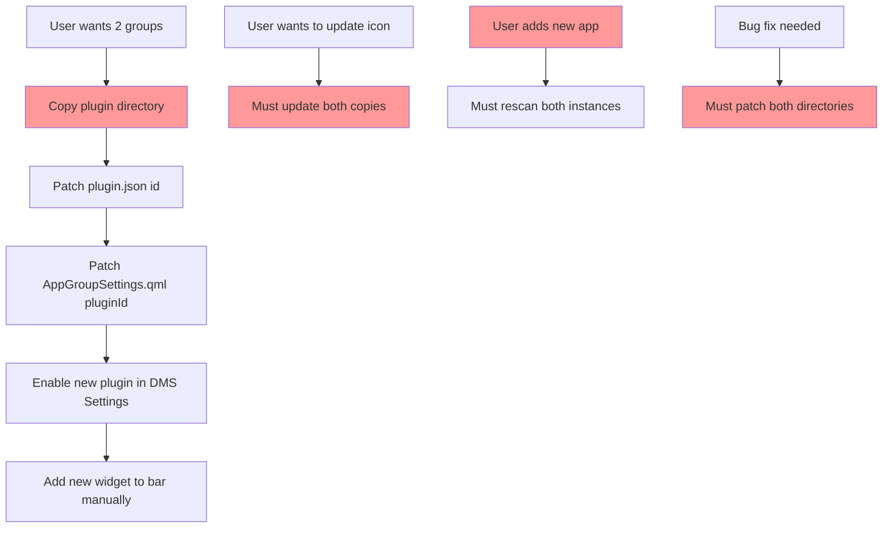
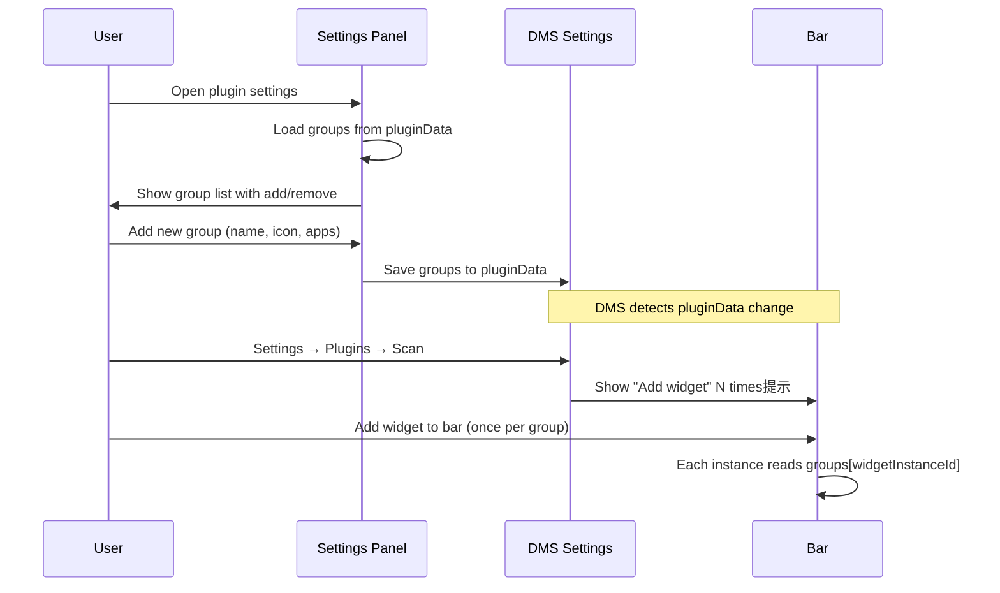

# Architecture Analysis: Multi-Group Improvement for Dux Shell App Stack Plugin

## 1. Current Architecture Understanding

### 1.1 Plugin Structure

```
dms-app-stack/
├── plugin.json              # Plugin manifest (id: "appStack_default")
├── AppGroupWidget.qml       # Bar widget component (PluginComponent)
├── AppGroupSettings.qml     # Settings panel (PluginSettings)
└── scripts/
    ├── list-apps.py         # Desktop file scanner → JSON
    └── create-group.sh      # Directory copier + sed patcher
```

### 1.2 How It Works Today

| Layer | Mechanism | Data Flow |
|-------|-----------|-----------|
| **Manifest** | `plugin.json` declares a `widget` type with `AppGroupWidget.qml` | Dux Shell loads one plugin instance per unique `id` |
| **Widget** | `AppGroupWidget.qml` extends `PluginComponent` | Reads `groupName`, `groupIcon`, `showLabel`, `appsData` from `pluginData` |
| **Settings** | `AppGroupSettings.qml` extends `PluginSettings` | Writes/reads settings via `pluginService.savePluginData()` |
| **Multi-Group Workaround** | `create-group.sh` copies the entire plugin directory | New directory = new plugin instance = new `id` in `plugin.json` |

### 1.3 Current Limitations



**Problems:**
1. **File duplication** — each group is a full copy of all plugin files
2. **Fragmented management** — each instance must be individually enabled and added to the bar
3. **Update burden** — bug fixes or feature additions require patching all copies via `sed`
4. **Hardcoded pluginId** — [`AppGroupSettings.qml`](AppGroupSettings.qml:4) has `pluginId: "appStack_default"`

---

## 2. Dux Shell API Capabilities (from documentation)

The documentation ([`Dux_Shell_Plugin_development_documentation.md`](docs/reference/Dux_Shell_Plugin_development_documentation.md)) reveals several key APIs:

### Auto-injected Properties on `PluginComponent`

| Property | Description | Relevance |
|----------|-------------|-----------|
| `pluginData` | Reactive settings object | Store `groups` array |
| `widgetInstanceId` | Distinguishes widget instances | **Maps bar slots to groups** |
| `variants` | Variant instances | Alternative multi-instance support |
| `pluginService` | Manual data operations | `savePluginData(pluginId, key, value)` |
| `pluginId` | Plugin's ID | Auto-injected, no hardcoding needed |
| `section` | "left", "center", or "right" | Bar positioning |
| `iconSize` | Recommended icon size | Responsive sizing |

### Key Documentation Quote

> "Don't assume a single instance. The same widget can sit on several bars and docks, and `widgetInstanceId` tells them apart."
> — [`Dux_Shell_Plugin_development_documentation.md`](docs/reference/Dux_Shell_Plugin_development_documentation.md:155)

### Composite Plugins

A single plugin can provide **multiple surfaces at once**, including multiple `widget` surfaces. Each surface is instantiated **per bar, per screen**:

```jsonc
{
  "type": "composite",
  "components": {
    "widget":   "./MyBarWidget.qml",
    "daemon":   "./MyDaemon.qml"
  }
}
```

---

## 3. Clarifying the Two Approaches

You asked for clarification on the distinction. Here is the accurate breakdown:

### Approach A: `widgetInstanceId` Mapping (Multiple Independent Placements)

**Concept:** You add the **same plugin** to the bar **multiple times** via DMS Settings. Each placement gets a unique `widgetInstanceId`. The widget maps each instance to a different group from a shared `groups` array.

```
User action: Add plugin to bar → Add plugin to bar again → ...
                    ↓                              ↓
            Instance 1 (widgetInstanceId=0)  Instance 2 (widgetInstanceId=1)
                    ↓                              ↓
              groups[0] = "Development"      groups[1] = "Browsers"
              pill shows "Dev" icon          pill shows "Chrome" icon
              popout shows Dev apps          popout shows Browser apps
```

**How it works:**
1. Settings panel stores `groups` array in `pluginData`
2. User adds the widget to the bar N times (once per group) via DMS Settings
3. Each instance receives a different `widgetInstanceId` (0, 1, 2, ...)
4. Widget reads `groups[widgetInstanceId]` to determine which group to display

**Placement flexibility:** HIGH — Each instance can be placed independently in any bar section (left, center, right) because each is a separate widget instance.

**Trade-off:** User must manually add the widget to the bar once per group via DMS Settings UI. If they add 3 groups, they must add the widget 3 times.

### Approach B: Repeater-Based Pills (Single Placement, Multiple Pills)

**Concept:** A **single widget instance** renders **all group pills** as children using QML's `Repeater`. The user adds the widget once, and all pills appear together.

```
User action: Add plugin to bar ONCE
                    ↓
            Single Instance
                    ↓
    ┌───────────────────────────────────────┐
    │  Repeater { model: groups }           │
    │    ├── BarPill { group[0] }           │  → "Dev" icon
    │    ├── BarPill { group[1] }           │  → "Chrome" icon
    │    └── BarPill { group[2] }           │  → "Office" icon
    └───────────────────────────────────────┘
```

**How it works:**
1. Settings panel stores `groups` array in `pluginData`
2. User adds the widget to the bar ONCE
3. Widget uses `Repeater` to render all pills as children
4. Each pill shows its group's icon and opens its group's popout

**Placement flexibility:** LOW — All pills are tied to one widget instance placement. They appear together in whatever section the user adds the widget to.

**Trade-off:** Simpler for the user (add once), but less flexible for placement.

---

## 4. Comparison Table

| Criterion | Approach A (widgetInstanceId) | Approach B (Repeater) |
|-----------|-------------------------------|----------------------|
| **Bar placements** | Each group = separate instance | All groups = one instance |
| **Independent placement** | ✅ Can place anywhere | ❌ All pills together |
| **User setup** | Add widget N times | Add widget once |
| **Dynamic groups** | Requires re-adding widget | Automatic (settings update) |
| **Implementation complexity** | Medium | Low |
| **Dux Shell API alignment** | High (documented pattern) | Medium (uncommon pattern) |

---

## 5. Recommended Architecture: Hybrid Approach

Since you mentioned that **independent placement** is important (being able to put widgets at the beginning, middle, or end of the bar), I recommend **Approach A** as the primary solution, with a settings-driven workflow to ease the setup burden.

### Data Model

```jsonc
{
  // Stored in pluginData via pluginService.savePluginData()
  "groups": [
    {
      "id": "group_0",
      "name": "Development",
      "icon": "mdi:code-braces-box",
      "showLabel": true,
      "apps": [
        { "name": "VS Code", "icon": "visual-studio-code", "exec": "code %U" }
      ]
    },
    {
      "id": "group_1",
      "name": "Browsers",
      "icon": "mdi:google-chrome",
      "showLabel": false,
      "apps": [
        { "name": "Firefox", "icon": "firefox", "exec": "firefox" }
      ]
    }
  ],
  "version": 2
}
```

### Settings Workflow



### Widget Code Pattern (Approach A)

```qml
// AppGroupWidget.qml (conceptual)
PluginComponent {
    id: root
    
    // widgetInstanceId is auto-injected by Dux Shell
    // Maps bar slot index to groups array index
    
    property var currentGroup: {
        if (!pluginData.groups || widgetInstanceId >= pluginData.groups.length)
            return null
        return pluginData.groups[widgetInstanceId]
    }
    
    // Bar pill uses currentGroup
    horizontalBarPill: Component {
        Row {
            visible: root.currentGroup !== null
            DIcon {
                name: root.currentGroup?.icon ?? "mdi:help-circle"
                size: root.iconSize
            }
            StyledText {
                text: root.currentGroup?.name ?? "Empty"
                visible: root.currentGroup?.showLabel ?? true
            }
        }
    }
    
    // Popout uses currentGroup.apps
    popoutContent: Component {
        PopoutComponent {
            visible: root.currentGroup !== null
            headerText: root.currentGroup?.name
            // Grid of apps from root.currentGroup.apps
        }
    }
}
```

---

## 6. Implementation Plan

### Phase 1: Data Model Migration

| Step | File | Action |
|------|------|--------|
| 1.1 | `plugin.json` | Keep unchanged (single plugin instance) |
| 1.2 | [`AppGroupWidget.qml`](AppGroupWidget.qml) | Refactor to read `groups` array, use `widgetInstanceId` |
| 1.3 | [`AppGroupSettings.qml`](AppGroupSettings.qml) | Refactor to manage `groups` array, remove hardcoded `pluginId` |
| 1.4 | New | Create `scripts/migrate-groups.py` for existing data |

### Phase 2: Widget Refactoring

| Step | File | Action |
|------|------|--------|
| 2.1 | [`AppGroupWidget.qml`](AppGroupWidget.qml) | Replace single-group logic with `groups[widgetInstanceId]` |
| 2.2 | [`AppGroupWidget.qml`](AppGroupWidget.qml) | Handle null/missing group gracefully |
| 2.3 | [`AppGroupWidget.qml`](AppGroupWidget.qml) | Remove hardcoded `groupName`, `groupIcon` properties |

### Phase 3: Settings Refactoring

| Step | File | Action |
|------|------|--------|
| 3.1 | [`AppGroupSettings.qml`](AppGroupSettings.qml) | Replace single-group settings with group list |
| 3.2 | [`AppGroupSettings.qml`](AppGroupSettings.qml) | Add group add/remove/reorder UI |
| 3.3 | [`AppGroupSettings.qml`](AppGroupSettings.qml) | Remove `create-group.sh` invocation |
| 3.4 | [`AppGroupSettings.qml`](AppGroupSettings.qml) | Remove hardcoded `pluginId` |

### Phase 4: Migration & Documentation

| Step | File | Action |
|------|------|--------|
| 4.1 | New | `scripts/migrate-groups.py` — scan existing `appStack_*` dirs |
| 4.2 | [`README.md`](README.md) | Update with new multi-group workflow |
| 4.3 | [`README.md`](README.md) | Document DMS Settings → add widget N times |

---

## 7. Feasibility Assessment

| Component | Feasibility | Risk | Dependencies |
|-----------|-------------|------|--------------|
| `widgetInstanceId` mapping | **HIGH** | Low | Dux Shell guarantees sequential IDs |
| `groups` array in `pluginData` | **HIGH** | Low | `pluginService.savePluginData()` |
| Settings refactoring | **HIGH** | Low | None (purely internal) |
| Migration script | **MEDIUM** | Low | Existing data format stability |
| User workflow (add widget N times) | **MEDIUM** | Medium | DMS Settings UI supports adding same plugin multiple times |

### Critical Unknowns

1. **Does DMS Settings allow adding the same plugin multiple times?**
   - If yes → Approach A works perfectly
   - If no → Must use Approach B (Repeater) or composite plugin with predefined surfaces

2. **Is `widgetInstanceId` guaranteed to be sequential (0, 1, 2, ...)?**
   - If yes → Simple array indexing works
   - If no → Need `PluginGlobalVar` to track mapping

3. **Does the widget handle `null` group gracefully?**
   - Must show empty pill or hide entirely

---

## 8. Files Requiring Changes

| File | Change Type | Description |
|------|-------------|-------------|
| [`AppGroupWidget.qml`](AppGroupWidget.qml) | **Rewrite** | Multi-group via `widgetInstanceId` |
| [`AppGroupSettings.qml`](AppGroupSettings.qml) | **Rewrite** | Unified settings for all groups |
| [`plugin.json`](plugin.json) | **None** | No changes needed |
| `scripts/migrate-groups.py` | **New** | Migration from old to new format |
| `scripts/create-group.sh` | **Remove** | Replaced by settings UI |
| [`README.md`](README.md) | **Update** | New usage documentation |

---

## 9. Conclusion

**Approach A (widgetInstanceId mapping)** is the recommended solution because it:
- Aligns with Dux Shell's documented multi-instance pattern
- Provides independent bar placement for each group
- Uses only standard, well-documented APIs

**Approach B (Repeater)** is the fallback if Approach A proves infeasible (e.g., if DMS Settings doesn't support adding the same plugin multiple times).

**Next step:** Confirm which approach you prefer, then switch to Code mode for implementation.
